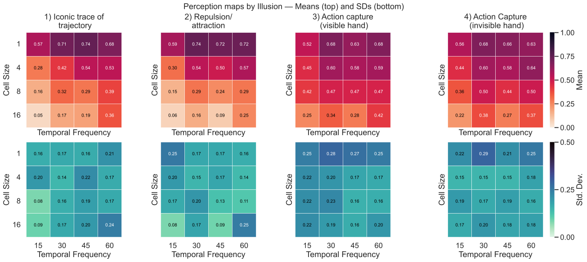
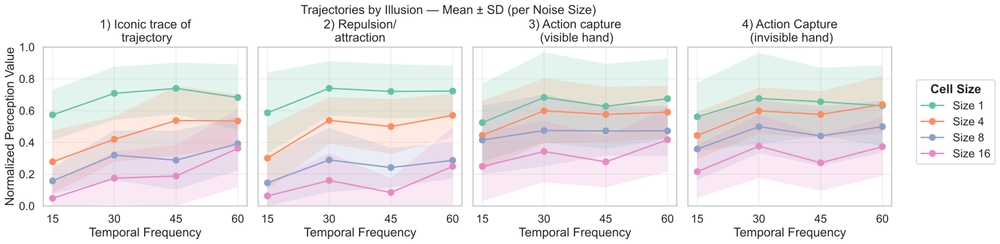
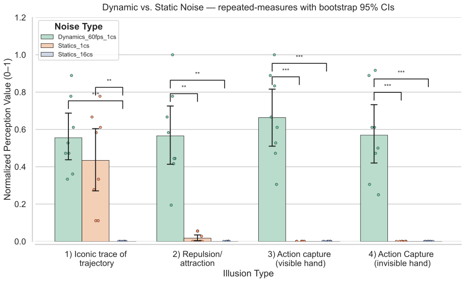
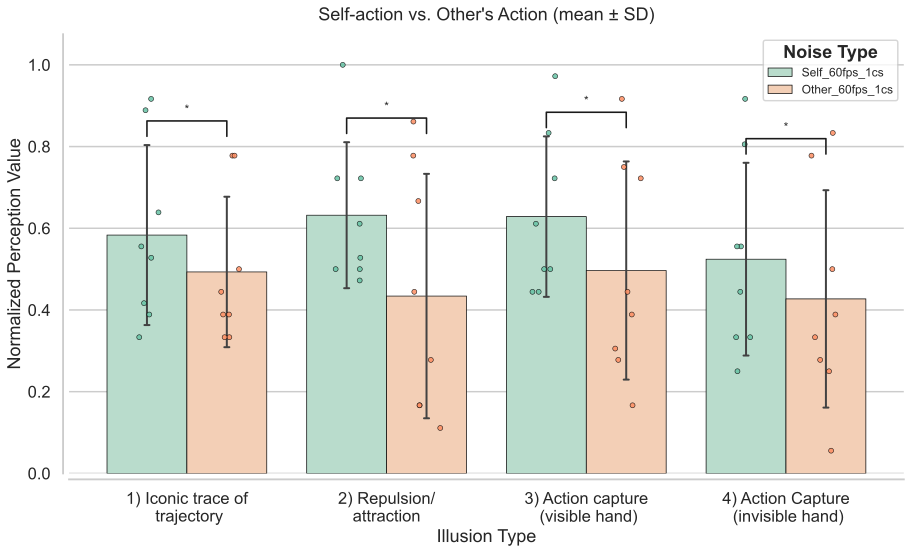

# Magnetic Sand Illusions

Code, analysis notebooks, and demonstrations accompanying **[“Magnetic sand”: Illusions of interactivity](https://doi.org/10.1167/jov.26.5.3)** by Shimojo et al. (*Journal of Vision*, 2026).

- **[Interactive demo (GitHub Pages)](https://cantonsir.github.io/Magnetic-Sand-Illusions/)**
- **[Original demonstrations (Google Sites)](https://sites.google.com/view/magneticsand)**

Move your hand near a display of random visual noise. The noise may appear to follow your movements, leave traces, or move toward and away from your fingers. The display is generated independently of your actions: the apparent interaction is a perceptual illusion.

## Interactive demo

The browser demo guides you through four hand movements. Watch the separate movement guide, then try the action with **your own hand** in front of the noise display—or behind it for the hidden-hand task.

| Experience | Illusion subtype | Movement |
| --- | --- | --- |
| Leave a trace | Iconic trace | Slowly trace a shape with a fingertip close to the screen. |
| Open & close | Attraction / repulsion | Open your fingers as you approach the screen; close them as you pull away. |
| The visible hand | Visible action capture | Move an open hand slowly from side to side near the screen. |
| The hidden hand | Invisible action capture | Reach behind the screen from the side. Keep the hand horizontal, palm facing you, and move it up and down while it stays out of sight. |

The demo includes:

- English and Simplified Chinese instructions, with separate animated movement guides.
- Fullscreen noise that fills the display edge to edge, with floating playback and exit controls.
- Dynamic and still noise, plus grain-size, refresh-rate, and contrast controls.
- Responsive phone layouts and a local record of which experiences you have tried.

Start the noise, enter fullscreen, and follow the selected hand movement. Use the play/pause button, **Space** to play or pause, or **Esc** to stop. Compare dynamic and still noise and record what you notice; seeing no change is also a valid observation. If flickering is uncomfortable, pause and use the still-noise option.

The actual stimulus contains random noise, with no gray dot or simulated hand. It does not use a camera or track your hand. This is an educational demonstration; screen size, pixel density, and refresh rate vary across devices, so it does not reproduce calibrated laboratory viewing conditions.

The interactive demo on GitHub Pages runs without Google services, external fonts, analytics, or an account. Availability still depends on your network.

### Run the demo locally

The static website is published from the [`codex/magnetic-sand-demo` branch](https://github.com/cantonsir/Magnetic-Sand-Illusions/tree/codex/magnetic-sand-demo). To run that version locally with Python installed:

```sh
git clone --branch codex/magnetic-sand-demo --single-branch https://github.com/cantonsir/Magnetic-Sand-Illusions.git magnetic-sand-demo
cd magnetic-sand-demo
python -m http.server 4173
```

Open [localhost:4173](http://localhost:4173/). The demo needs no package installation or build step. Serve it over HTTP rather than opening `index.html` directly, because it uses JavaScript modules.

## Research paper and citation

Please cite the published paper when using this work:

Shimojo, S., Zheng, S., Shimojo, K., Shimojo, E., & Wu, D.-A. (2026). “Magnetic sand”: Illusions of interactivity. *Journal of Vision, 26*(5), 3. [https://doi.org/10.1167/jov.26.5.3](https://doi.org/10.1167/jov.26.5.3)

```bibtex
@article{shimojo2026magnetic,
  author  = {Shimojo, Shinsuke and Zheng, Shengjie and Shimojo, Kensuke and Shimojo, Eiko and Wu, Daw-An},
  title   = {"Magnetic sand": Illusions of interactivity},
  journal = {Journal of Vision},
  year    = {2026},
  volume  = {26},
  number  = {5},
  pages   = {3},
  doi     = {10.1167/jov.26.5.3},
  url     = {https://doi.org/10.1167/jov.26.5.3}
}
```

The [2024 bioRxiv preprint](https://www.biorxiv.org/content/10.1101/2024.07.03.598775v2) is retained here for publication history; the citation above refers to the published journal article.

## Research code and analysis

The `main` branch contains the research notebooks and figures. You can open the notebooks locally in Jupyter; Google Colab links are provided as an optional alternative. See [requirements.txt](requirements.txt) for Python dependencies and each notebook for its input paths and analysis details.

| Notebook | Purpose | Optional Colab |
| --- | --- | --- |
| [Noise video generator](Videos/Magnetic_sand_illusion.ipynb) | Generate noise videos with different cell sizes and temporal frequencies. | [Open in Colab](https://colab.research.google.com/github/cantonsir/Magnetic-Sand-Illusions/blob/main/Videos/Magnetic_sand_illusion.ipynb) |
| [Parameter sensitivity](Notebook/01_Parameter_Space.ipynb) | Explore how cell size and temporal frequency affect illusion ratings. | [Open in Colab](https://colab.research.google.com/github/cantonsir/Magnetic-Sand-Illusions/blob/main/Notebook/01_Parameter_Space.ipynb) |
| [Dynamic vs. static noise](Notebook/02_Statics_vs_Dynamics.ipynb) | Compare ratings across dynamic and static noise conditions. | [Open in Colab](https://colab.research.google.com/github/cantonsir/Magnetic-Sand-Illusions/blob/main/Notebook/02_Statics_vs_Dynamics.ipynb) |
| [Self-action vs. observing others](Notebook/03_Self_vs_Other.ipynb) | Compare performing a movement with observing another person's movement. | [Open in Colab](https://colab.research.google.com/github/cantonsir/Magnetic-Sand-Illusions/blob/main/Notebook/03_Self_vs_Other.ipynb) |

### Parameter sensitivity

**Mean illusion ratings**


**Perception maps**



**Trajectories by illusion**



### Dynamic vs. static noise



### Self-action vs. observing others



## Repository structure

- [`Videos/`](Videos/): noise-video generation notebook.
- [`Notebook/`](Notebook/): analysis notebooks.
- [`Figure/`](Figure/): research figures and visualizations.
- [`requirements.txt`](requirements.txt): Python dependencies for the research code.
- [`codex/magnetic-sand-demo`](https://github.com/cantonsir/Magnetic-Sand-Illusions/tree/codex/magnetic-sand-demo): separate branch containing the public website's static files.

## License

The repository code is released under the [MIT license](LICENSE.txt). Please also cite the research paper when using the work.
